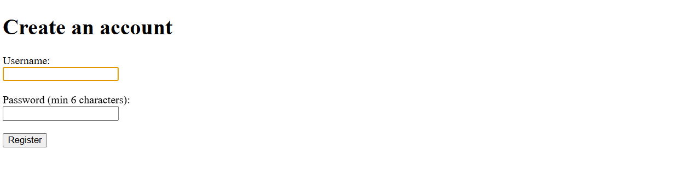
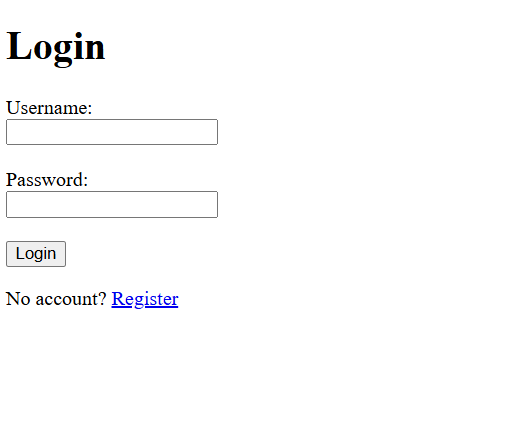

# Expense Tracker

A Flask web app to track personal expenses, with charts and budgets.

## Features
- Register, login, logout (hashed passwords)
- Add, edit, delete expenses (per-user data)
- Filter by category and month
- Pie chart (categories) and bar chart (monthly trend)
- Monthly budget with over-budget warning
- CSV export
- Automated tests with pytest

## Tech Stack
Python, Flask, SQLAlchemy, SQLite, Flask-Login, Chart.js

## Run locally
    python -m venv venv
    venv\Scripts\activate
    pip install -r requirements.txt
    python app.py

## Run tests
    pytest

## Live demo
(add your link here after deploying)

## Screenshots

